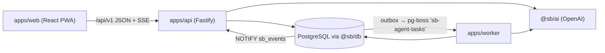

# Repository Guidelines

## Project Overview

`seongbuk-sharing` (성북 공유대여): Korean mobile PWA for neighborhood item sharing/rental, with API and background worker. Current code is an MVP; it performs **no real payments or institutional reservations**.

Modules:

- **Module 1 — intake agent (접수 에이전트, voice/text rental request): PROTECTED. Do not change its functionality or behavior.**
- Module 2 — AI item registration; Module 3 — item browse/rental management; remaining MVP code. These may be replaced per specs.

Authoritative policy: `docs/current/MODULE_BOUNDARIES.md`, `docs/current/DEVELOPMENT.md`, `docs/current/AI_WORKFLOW.md`. `docs/archive/mvp/` is historical, **not** current requirements; don't use it as a spec.

**Hard rule:** run `npm run check:boundaries` before handoff. Never edit the hashed module 1 files, regenerate `scripts/module-1-baseline.json`, or weaken the checker. Details are in [Module 1 Protection](#module-1-protection-mandatory) and `docs/current/MODULE_BOUNDARIES.md`.

## Architecture & Data Flow



- **Contracts first**: `packages/contracts/src/{http,entities,ai,listing,intake,reservation}.ts` hold Zod schemas + inferred types shared by every workspace. `openapi.ts` registers operations; `npm run openapi` regenerates `packages/contracts/openapi.json` (generated, never hand-edit).
- **Web** (`apps/web/src/lib/api.ts`): calls `/api/v1`, validates envelopes/payloads with Zod, keeps canonical request bytes + idempotency keys for retries via `ActionScope`/`CommandIntent`.
- **API** (`apps/api/src/index.ts`): injectable `buildApi(options)` factory; session/CSRF/mutation helpers; feature plugins in `apps/api/src/{voice,listings,intake-approvals,reservations}/index.ts`. `apps/api/src/sse.ts` streams durable events, woken by `LISTEN sb_events` with polling fallback.
- **DB** (`packages/db/src`): raw parameterized SQL with `pg`, no ORM. `database.ts`, `commands.ts`, `unit.ts`, `storage.ts` implement domain commands/transactions; `Database.transaction` flushes before commit; idempotency uses transaction advisory locks. Migrations: `packages/db/migrations/NNN_name.sql`, applied by `migrate.ts` under an advisory lock.
- **Worker** (`apps/worker/src/worker.ts`, `RentalWorker`): dispatches transactional outbox into pg-boss queue `sb-agent-tasks` with singleton keys, recovers queued/running tasks, runs AI/search jobs, periodically sweeps expiry/reservations.
- **AI** (`packages/ai/src/{ports,runtime,transport,registration}.ts`, `agents/`): OpenAI adapters with validated outputs and bounded retries. `AI_MODE=fixture` swaps in `FixtureTransport` (`fixtures.ts`). `voice.ts`: OpenAI Realtime WebRTC + server WebSocket control; **fixture mode does not simulate voice**.
- Cross-module rules: ownership crosses modules via HTTP/JSON only; never write another module's storage directly; publishing, requests, approval, and cancellation need human confirmation + server validation.

## Key Directories

| Path                                     | Purpose                                                                                                                                                                |
| ---------------------------------------- | ---------------------------------------------------------------------------------------------------------------------------------------------------------------------- |
| `apps/web/src/features/`                 | Pages by feature: `voice-call/` (current `/rental` call UI), `rental/` (classic `/rental/classic`), `listing/`, `reservation/`, `center/`, `center-board/`, `account/` |
| `apps/web/src/lib/`                      | API client, voice clients, shared browser logic                                                                                                                        |
| `apps/api/src/`                          | Fastify server, plugins, SSE; `voice/` = module 1 (protected)                                                                                                          |
| `apps/worker/src/`, `apps/worker/tests/` | Worker and its tests                                                                                                                                                   |
| `packages/contracts/`                    | Zod schemas, OpenAPI generator                                                                                                                                         |
| `packages/db/`                           | Domain layer, migrations, seed, test DB helpers                                                                                                                        |
| `packages/ai/`                           | OpenAI adapters, fixtures, voice                                                                                                                                       |
| `packages/demo-data/`                    | Seed scenarios (`cli.ts` → `npm run -w @sb/demo-data print`)                                                                                                           |
| `tests/acceptance/`                      | Cross-service Vitest acceptance tests (`harness.ts`)                                                                                                                   |
| `tests/e2e/`                             | Playwright + axe browser tests                                                                                                                                         |
| `infra/`                                 | `stack.mjs`/`e2e.mjs`, Caddyfile, runtime Dockerfile                                                                                                                   |
| `docs/current/`, `docs/specs/`           | Current policy; numbered specs                                                                                                                                         |

## Development Commands

Run from repo root:

```sh
npm ci
cp .env.example .env              # set OPENAI_API_KEY
npm run up                        # build web, start DB, migrate, API/worker/Caddy → http://localhost:8000
npm run seed -- --scenario default  # RESETS dev DB business data; coordinate on shared DB
npm run down                      # stops app services; keeps PostgreSQL + volume
npm run dev                       # Vite dev server 127.0.0.1:5173, proxies /api → 127.0.0.1:3000
npm run -w @sb/api dev            # API watch mode (tsx, loads root .env if present)
npm run -w @sb/worker dev
npm run -w @sb/db migrate

npm run check:boundaries          # module 1 hash check (also the only CI job)
npm run typecheck                 # `npm run lint` is an alias
npm test
npm run build
npm run openapi                   # after contract changes
npm run format                    # Prettier
```

Never run `docker compose down -v` against the shared DB. Ports: PostgreSQL `127.0.0.1:54329`, API `3000` (internal), Caddy `127.0.0.1:8000`.

## Code Conventions & Common Patterns

- **Formatting**: Prettier — single quotes, trailing commas everywhere, width 100. Don't format generated `openapi.json` or lockfile (ignored).
- **ESM + strict TS**: `"type": "module"` everywhere; relative imports use `.js` extension (`import { x } from './commands.js'`). `tsconfig.base.json`: NodeNext, `strict`, `noUncheckedIndexedAccess`, `exactOptionalPropertyTypes`, `verbatimModuleSyntax` (use `import type`), `isolatedModules`. No path aliases; import other workspaces as `@sb/contracts`, `@sb/db`, `@sb/ai`, `@sb/demo-data`. Web uses Bundler resolution + `react-jsx`.
- **Naming**: React components PascalCase files (`VoicePage.tsx`); helpers lowercase/kebab-case (`voice-completion.ts`); camelCase functions; PascalCase types, classes, Zod schemas.
- **Errors**: domain code throws `DomainError` / `fail(...)`; API `errorResponse` maps to `{ error: { code, message, retryable, details }, meta }`; Zod failures → 422. Web wraps failures in `ApiError`; AI uses `AiAdapterError`. Never serialize provider exceptions into logs.
- **Dependency injection**: factories take injected clocks, pools, AI ports, transports (`buildApi(options)`, `RentalWorker`). Keep new code injectable so tests can swap fixtures.
- **Async**: plain `async`/`await`. Durable background work goes through the DB transactional outbox → pg-boss (`sb-agent-tasks`). Best-effort side effects (voice `append`, SSE `drain`, cleanup) are intentionally fire-and-forget with `void fn()` plus `.catch` / `diagnostic(...)`; don't `void` anything that must persist.
- **Web state**: React Query for server state, React Router `useRoutes` with lazy pages in `App.tsx`, session context and React Aria `ko-KR` provider in `main.tsx`, local `useState` for page state. Korean UI/error strings are inline.
- **Config**: read from `process.env`; API/worker load root `.env` via `node --env-file-if-exists=../../.env`. Names in `.env.example` (`OPENAI_API_KEY`, `OPENAI_*_MODEL`, `DATABASE_URL`, `APP_ORIGIN`, `AI_MODE`, `APP_MODE`, `SEED_SCENARIO`). Live AI is default and needs `OPENAI_API_KEY`. Browser API mock: dev mode + `VITE_API_MOCK=1`.
- **DB changes**: add the next ordered `packages/db/migrations/00N_*.sql` (`migrate.ts` records applied files); prefer a new migration over editing one that may already be applied on the shared dev DB.

## Module 1 Protection (mandatory)

`scripts/check-module-boundary.mjs` verifies SHA-256 of 22 files in `scripts/module-1-baseline.json`:

- `apps/api/src/voice/*` (`bindings`, `completion-audio`, `guards`, `index`, `voice.test`), `apps/api/test/voice-*.ts`, `apps/api/test/fixtures/voice/korean-request.wav`
- `apps/web/src/features/rental/{NeedEditor,VoicePage}.tsx`, `apps/web/src/lib/{voice,voice-completion}.ts` (+ tests), `apps/web/scripts/verify-voice-completion.mjs`
- `packages/ai/src/{voice,voice-turn}.ts` (+ tests), `packages/db/src/voice.test.ts`

Rules:

- Never edit these files, regenerate hashes, or modify the checker to pass. No baseline-update procedure exists.
- The hash list is a minimum. Intake behavior in shared contracts, API, worker, DB, AI, routing, UI, and styles is also protected; a file absent from the baseline is **not** permission to change intake behavior.
- Shared-file changes need an impact search of real callers, regression tests, and a `reviewer` boundary review.

## Specs & Workflow

- Classify before coding (`docs/current/DEVELOPMENT.md`):
  - **Full spec** (`docs/specs/TEMPLATE.md`): cross-module API/events, ownership, DB schema/migrations, shared module 1 usage.
  - **Card** (`docs/specs/CARD_TEMPLATE.md`): module 2/3 internal feature or user-visible change.
  - Otherwise no spec.
- File as `docs/specs/NNNN-short-name.md` (next free number); update `docs/specs/README.md` index, status, and actual verification. Draft ≠ agreed contract.
- AI flow (`docs/current/AI_WORKFLOW.md`): `start-task → write-spec → implementation → contract-change → verify → boundary-review` as applicable. Max 3 concurrent subagents, no nesting.
- PRs link the spec and state module 1 impact.

## Important Files

- Entry points: `apps/web/src/main.tsx`, `apps/web/src/App.tsx`, `apps/api/src/server.ts`, `apps/worker/src/main.ts`
- Contracts: `packages/contracts/src/index.ts`, `packages/contracts/src/openapi.ts`, `packages/contracts/scripts/generate-openapi.ts`
- DB: `packages/db/src/database.ts`, `migrate.ts`, `seed.ts`, `testing.ts`
- AI runtime/mode switch: `packages/ai/src/runtime.ts`, `fixtures.ts`
- Infra: `docker-compose.yml`, `infra/scripts/stack.mjs`, `infra/scripts/e2e.mjs`, `infra/Caddyfile`, `infra/runtime.Dockerfile`, `apps/web/vite.config.ts`
- Guards/tooling: `scripts/check-module-boundary.mjs`, `scripts/module-1-baseline.json`, `.github/workflows/module-boundary.yml`, `scripts/agents-sync.mjs`

## Runtime/Tooling Preferences

- Node `>=26.8.2 <27`, **npm 11 only** (`packageManager: npm@11.19.1`); no pnpm/yarn/bun. `.npmrc` `save-exact=true`, so pin exact versions. Install scripts limited by `allowScripts` in root `package.json`.
- TypeScript 7 for typecheck only (`noEmit`); TS runs through **`tsx`** (`node --import tsx`), not native type stripping.
- Docker Compose for PostgreSQL 16 and runtime stack.
- `scripts/agents-sync.mjs` generates `.claude/agents/*`, `.codex/agents/*.toml`, `.codex/config.toml`, `.claude/skills` links from `.agents/tiers.json` + `.agents/roles/*.md`. Edit `.agents/` sources, then `npm run agents:sync`; never edit generated files. `agents:sync`/`agents:check` currently fail: `.agents/` and `.claude/settings.json` don't exist yet. `AGENTS.md` itself is hand-maintained, not generated by `agents-sync`.
- Never read or commit `.env`, keys, or build output.

## Testing & QA

- **Vitest 5** (node environment for every project, including web). Root `vitest.config.ts` aggregates `apps/*/vitest.config.ts` and `packages/*/vitest.config.ts`; each includes `src/**/*.test.ts` and `tests/**/*.test.ts`. Tests sit beside source as `*.test.ts` (worker: `apps/worker/tests/`).
  ```sh
  npm test -- --project @sb/web
  npm test -- apps/web/src/lib/api.test.ts
  npm test -- -t 'test name'
  ```
- **PostgreSQL required** for DB/API/worker and acceptance tests: `npm run db:up` first. `createTestDatabase()` (`packages/db/src/testing.ts`) creates `sb_test_<uuid>` from `TEST_DATABASE_URL` (default `postgres://sb:sb@127.0.0.1:54329/sb`), migrates, seeds, drops on cleanup; user needs CREATE/DROP DATABASE.
- **Acceptance**: `npm run test:acceptance` (`tests/acceptance/`, `AI_MODE=fixture`, `APP_MODE=automated-test`, ≤3 workers). `harness()`/`fixture()`/`until()` wire real API + DB + worker. Test names carry `AT` criterion IDs.
- **E2E**: `npm run test:e2e` → Playwright Chromium, 390×844, `ko-KR`, Asia/Seoul, 1 worker; private `sb_e2e_<uuid>` DB in fixture mode; axe audits fail on critical violations (reports in `test-artifacts/e2e/axe`). Unfiltered run also runs `E2E_SCENARIO=expiry-fast`; passing any args skips that second run.
- Fakes: `AI_FIXTURES`/`FixtureTransport` for AI; injected fake fetcher for the OpenAI SDK (`packages/ai/src/ports.test.ts`); web tests use `vi.stubGlobal`, `vi.fn`, fake timers.
- No coverage threshold. CI runs only the boundary check, so run `check:boundaries`, `typecheck`, `test`, `build` locally before handoff. Real human voice, phone, and screen-reader checks are manual; old results don't validate the current version.
