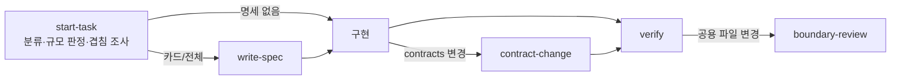

# AI 작업 흐름

Claude Code와 Codex가 같은 스킬·에이전트·모델 단계로 작업하도록 저장소에 설정해 두었다. 개발자는 템플릿을 직접 채우지 않는다. 요청하면 AI가 대상을 분류하고 명세 초안을 쓰고 검증한다. 사람은 AI가 모아서 묻는 결정 질문에 답한다.

이 문서는 세팅 안내와 기본값을 바꾸는 방법을 다룬다. 저장소 규칙은 [AGENTS.md](../../AGENTS.md), 1번 보호 범위는 [모듈 경계](MODULE_BOUNDARIES.md)가 기준이다.

## 처음 세팅

| 도구        | 할 일                                                                                                                                                                                                        |
| ----------- | ------------------------------------------------------------------------------------------------------------------------------------------------------------------------------------------------------------ |
| 공통        | 저장소 루트에서 새 세션을 시작한다. 지침·에이전트를 바꾼 뒤에도 새 세션으로 다시 시작한다                                                                                                                    |
| Claude Code | 추가 설정 없음. `/skills`에 5개 스킬, `/agents`에 프로젝트 에이전트가 보이는지 확인한다                                                                                                                      |
| Codex       | 프로젝트를 trusted로 등록한다 (첫 실행 시 묻는 trust에 동의하거나 `~/.codex/config.toml`의 `[projects."<저장소 절대경로>"] trust_level = "trusted"`). 신뢰하지 않으면 `.codex/config.toml`이 로드되지 않는다 |
| Windows     | 스킬 연결이 심볼릭 링크다. `git config core.symlinks true`와 개발자 모드를 켠 뒤 clone한다                                                                                                                   |

## 작업 흐름

평소처럼 작업을 요청하면 스킬이 자동으로 호출된다. 직접 부를 때는 Claude에서 `/스킬명`, Codex에서 `$스킬명`을 쓴다.



| 스킬              | 하는 일                                                                                                |
| ----------------- | ------------------------------------------------------------------------------------------------------ |
| `start-task`      | 경계 검사, 1·2·3번·공용 분류, 명세 규모(없음/카드/전체) 판정과 한 줄 근거, 겹치는 기능 조사, 계획 제시 |
| `write-spec`      | `docs/specs/NNNN-*.md`에 카드·전체 명세 초안 작성, 목록 등록, 결정 질문을 모아 한 번에 질문            |
| `contract-change` | 1번 계약 보존 확인 → `npm run openapi` → contracts 테스트 → 소비자 확인                                |
| `verify`          | 바뀐 경로에 맞는 검증 선택·실행, DB가 필요하면 `npm run db:up`, 결과를 명세에 기록                     |
| `boundary-review` | 공용 파일을 바꿨을 때 `reviewer`로 1번 영향·모듈 경계 위반 검토                                        |

명세 규모 기준:

| 규모      | 기준                                                                                    |
| --------- | --------------------------------------------------------------------------------------- |
| 전체 명세 | 모듈 간 API·이벤트, 데이터 소유권, DB 스키마·마이그레이션, 공용 파일 중 1번이 쓰는 부분 |
| 카드      | 2·3번 내부 새 기능, 사용자에게 보이는 동작 변경, 기존 기능 대체·통합                    |
| 없음      | 그 외 (버그 수정, 내부 리팩터링, 문서·테스트 보강)                                      |

AI의 판정이 틀리면 "카드로 해" 처럼 규모를 지정하면 된다. 결정이 남아 있어도 그 결정에 의존하지 않는 범위는 계속 진행한다.

Claude Code는 이름이 `verify`인 프로젝트 스킬이 있으면 내장 `/verify` 대신 이 스킬을 쓰고, 커밋 직전에 실행한다(문서·테스트만 바꾼 커밋 제외).

## 에이전트와 모델 단계

서브에이전트는 세 단계로 나눈다. 각 회사 안에서 모델 수준을 나눈 것이며 두 도구를 함께 쓴다는 가정은 없다.

| 단계 | Claude Code       | Codex                    | 에이전트                      |
| ---- | ----------------- | ------------------------ | ----------------------------- |
| T1   | `haiku` · low     | `gpt-6-luna` · high      | `explorer`, `verifier`        |
| T2   | `sonnet` · medium | `gpt-6.1-terra` · medium | `implementer`, `spec-drafter` |
| T3   | `opus` · high     | `gpt-6.1-sol` · high     | `reviewer`                    |

| 에이전트       | Claude 이름                   | Codex 이름             | 권한                        |
| -------------- | ----------------------------- | ---------------------- | --------------------------- |
| `explorer`     | `Explore` (내장 대체)         | `explorer` (내장 대체) | 읽기 전용                   |
| `verifier`     | `verifier`                    | `verifier`             | 명령 실행만, 파일 수정 없음 |
| `implementer`  | `general-purpose` (내장 대체) | `worker` (내장 대체)   | 지정 범위 수정              |
| `spec-drafter` | `spec-drafter`                | `spec_drafter`         | `docs/specs/`만 수정        |
| `reviewer`     | `reviewer`                    | `reviewer`             | 읽기 전용                   |

- 서브에이전트에는 `fable`, `ultra`, xhigh 이상을 쓰지 않는다. 메인 세션의 모델·effort는 개발자가 고른다(권장값 없음).
- 이름 없이 띄운 서브에이전트의 기본값은 T2다 (Claude `CLAUDE_CODE_SUBAGENT_MODEL=sonnet`, Codex `agents.default_subagent_model`).
- Claude의 내장 `Plan` 에이전트(plan 모드 조사)는 대체하지 않았으므로 메인 세션 모델을 따른다.

### 제한이 걸리는 방식

| 규칙                    | Claude Code                                     | Codex                                                  |
| ----------------------- | ----------------------------------------------- | ------------------------------------------------------ |
| 에이전트별 모델·effort  | 설정 (`.claude/agents/*.md`)                    | 설정 (`.codex/agents/*.toml`)                          |
| 동시 실행 최대 3개      | 지침 (`start-task` 스킬)                        | 설정 (`agents.max_concurrent_threads_per_session = 3`) |
| 서브에이전트 중첩 금지  | 설정 (에이전트에서 `Agent` 도구 제외)           | 지침 (에이전트 지침)                                   |
| 읽기 전용 에이전트      | 설정 (`Edit`·`Write` 제외)                      | 지침 (Codex는 에이전트별 sandbox를 지원하지 않음)      |
| 1번 전용 파일 편집 금지 | 설정 (`.claude/settings.json` deny) + 경계 검사 | 경계 검사 (`npm run check:boundaries`)                 |

## 기본값을 따르지 않을 때

저장소의 공유 설정은 고치지 않는다. 아래 개인 설정으로 바꾼다.

| 하고 싶은 것                           | Claude Code                                                                                                                      | Codex                                                                                                                                                      |
| -------------------------------------- | -------------------------------------------------------------------------------------------------------------------------------- | ---------------------------------------------------------------------------------------------------------------------------------------------------------- |
| 한 번만 더 높은 모델로 위임            | 요청에 명시: "reviewer를 opus로 실행해". 호출 시 지정한 모델이 에이전트 정의보다 우선한다                                        | 프로젝트 에이전트 파일의 모델이 우선하므로, 내장 `default` 에이전트에 모델을 지정해 요청: "default 에이전트를 gpt-6.1-sol high로 띄워 리뷰해"              |
| 모든 서브에이전트를 한 모델로 고정     | `.claude/settings.local.json`의 `env`에 `CLAUDE_CODE_SUBAGENT_MODEL`과 `CLAUDE_CODE_SUBAGENT_MODEL_FORCE: "1"`                   | `-c agents.default_subagent_model=...`은 `default`·이름 없는 서브에이전트에만 적용된다. 프로젝트 에이전트는 파일 값이 우선이므로 `default` 에이전트로 요청 |
| effort 일괄 고정                       | `.claude/settings.local.json`의 `env.CLAUDE_CODE_EFFORT_LEVEL` (메인 세션에도 적용됨)                                            | `-c agents.default_subagent_reasoning_effort=...` (프로젝트 에이전트 파일 값이 우선)                                                                       |
| 동시 실행 상한 변경                    | 지침이므로 요청에 명시: "에이전트 5개 병렬로"                                                                                    | `codex -c agents.max_concurrent_threads_per_session=5` (매번 쓰기 번거로우면 셸 alias)                                                                     |
| 서브에이전트를 전혀 쓰지 않음          | `.claude/settings.local.json`의 `permissions.deny`에 `"Agent"`                                                                   | `codex -c agents.enabled=false`                                                                                                                            |
| 프로젝트 에이전트 끄기 (내장으로 복귀) | `claude --agents '<JSON>'`으로 같은 이름 정의를 세션 한정으로 덮어쓰기                                                           | 해당 세션에서는 `default` 에이전트에 모델을 지정해 요청                                                                                                    |
| 스킬 자동 호출 끄기                    | `.claude/settings.local.json`의 `"skillOverrides": { "<스킬명>": "user-invocable-only" }` (`/스킬명`으로만 실행), `"off"`면 숨김 | 자동 호출만 끄는 개인 설정은 없다. 스킬을 끄려면 `~/.codex/config.toml`의 `[[skills.config]]`에 `name = "<스킬명>"`, `enabled = false`                     |

Codex 설정 우선순위는 CLI `-c` > 프로젝트 `.codex/config.toml` > `--profile` 파일 > 개인 `~/.codex/config.toml`이다. 그래서 profile이나 개인 `config.toml`에 적은 `[agents]` 값은 프로젝트 값을 덮지 못하고, `-c`만 덮는다. Claude는 `.claude/settings.local.json`이 프로젝트 `settings.json`보다 우선하며 공유되지 않는다. `.claude/settings.local.json`으로 1번 deny를 풀지 않는다.

## 설정을 바꿀 때 (공유 설정)

에이전트·단계·스킬을 팀 전체에 바꾸려면 원본만 고친다.

| 원본                        | 내용                                                                |
| --------------------------- | ------------------------------------------------------------------- |
| `.agents/tiers.json`        | 단계별 회사·모델·effort, 기본 서브에이전트 단계, 동시 실행 상한     |
| `.agents/roles/*.md`        | 에이전트 역할: `tier`, `access`, 도구별 이름, 설명, 지침            |
| `.agents/skills/*/SKILL.md` | 공용 스킬. Codex는 직접 읽고 Claude는 `.claude/skills/` 링크로 읽음 |

```sh
npm run agents:sync    # .claude/agents, .codex/agents, .codex/config.toml, .claude/settings.json env, .claude/skills 링크 생성
npm run agents:check   # 생성물이 원본과 같은지 확인 (커밋 전)
```

생성 파일은 직접 고치지 않는다. 개인용 에이전트·스킬은 `~/.claude/agents`, `~/.codex/agents`, `~/.agents/skills`에 둔다. Claude Code는 같은 이름이면 프로젝트 에이전트를 개인 에이전트보다 우선한다.

새 모델이 나오면 Claude는 별칭(`haiku`/`sonnet`/`opus`)이라 자동으로 따라가고, Codex는 `.agents/tiers.json`의 모델명을 바꾼 뒤 `agents:sync`를 실행한다.
